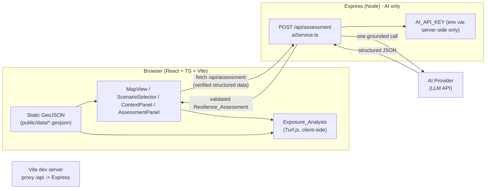

# Design Document

## Overview

HarborGuard is a single-page coastal resilience app for East Boston, built to satisfy the approved `requirements.md` within a solo hackathon budget of ~2-3 hours. The design deliberately favors a small, coherent React app over layered abstraction. All flood and station geometry is **already verified and prepared** as static GeoJSON under `data/processed/`; the app serves these as static assets and never queries or clips the statewide MC-FRM at runtime (Requirement 10, Requirement 8.8). A single lightweight Express endpoint exists solely to keep the AI credential server-side (Requirement 5.6, 9.2, 9.7).

The design traces directly to the requirements glossary. Named UI pieces map to components: `Map_View` → `MapView`, `Scenario_Selector` → `ScenarioSelector`, `Neighborhood_Selector` → `NeighborhoodSelector`, `Context_Panel` → `ContextPanel`, `AI_Service` → `server/aiService.ts` behind `POST /api/assessment`. The `Exposure_Analysis` runs client-side with Turf.js against the loaded `Flood_Layer`.

P0 is the acceptance baseline: an attractive East Boston map, 2050↔2070 scenario switching, verified flood visualization with legend/attribution, the 5 Blue Line stations with evidence-based exposure (including the boundary-undetermined state), full `Source_Attribution` / `Data_Category` labeling, and a working source-grounded `Resilience_Assessment`. P1 (context panel detail, responsive polish) and P2 (strategy comparison, briefing, more neighborhoods) are stretch and must not block the P0 East Boston flow (Requirement 2.8).

## Architecture



Key boundaries:
- **Static GeoJSON is served to the browser** from `public/data/`. Leaflet renders it; Turf computes exposure. No flood data flows through the server.
- **The Express server only ever sees the AI call.** The AI credential lives in `AI_API_KEY` (env) and is never shipped to the browser (Requirement 9.7).
- In dev, Vite proxies `/api` → `http://localhost:PORT` so the browser uses a single origin.

## Components and Interfaces

Small, focused files. Concrete tree (new app lives at repo root):

```
HarborGuide/
  index.html
  package.json                 # React, Vite, Tailwind, react-leaflet, leaflet, @turf/*
  vite.config.ts               # Vite + dev proxy /api -> Express
  tailwind.config.js
  .env.example                 # AI_API_KEY=, AI_MODEL=, PORT=8787
  public/
    data/
      eastboston_flood_2050.geojson      # copied from data/processed/
      eastboston_flood_2070.geojson
      eastboston_mbta_blue_stations.geojson
  src/
    main.tsx
    App.tsx                    # layout: map + panels, holds selection state
    index.css                  # tailwind directives
    types.ts                   # shared TS interfaces (Scenario, Station, Exposure, Assessment)
    config/
      scenarios.ts             # 2050/2070 metadata, labels, legend, data categories
      neighborhoods.ts         # East Boston reference stats (from neighborhoods CSV)
      strategies.ts            # curated source-grounded adaptation guidance options
    lib/
      geojson.ts               # fetch + cache the 3 static GeoJSON files
      exposure.ts              # Exposure_Analysis: Turf classification + 30m caution
      provenance.ts            # Source_Attribution + Data_Category helpers
    components/
      MapView.tsx              # react-leaflet map, base tiles, Flood_Layer, station markers
      ScenarioSelector.tsx     # 2050/2070 toggle, default 2050
      NeighborhoodSelector.tsx # East Boston (others = config-driven, P2)
      Legend.tsx               # symbology + units + scenario label + attribution
      SourceBadge.tsx          # one-click reveal of Source_Attribution (Req 8.4)
      CategoryTag.tsx          # renders one of 5 Data_Category labels
      ContextPanel.tsx         # exposure results, neighborhood context, limitations
      AssessmentPanel.tsx      # Generate button, loading, result, retry, AI label
      StrategyComparison.tsx   # P2 stretch: 2-3 strategy side-by-side
      LoadingState.tsx / ErrorState.tsx
  server/
    index.ts                   # Express app, serves /api/assessment
    aiService.ts               # builds prompt, calls AI, validates JSON + numeric guard
    validate.ts                # schema + no-hallucination numeric-claim check
    prompt.ts                  # system prompt + structured-data serialization
```

## Data Models

The prepared assets are treated as read-only inputs. CSV-derived facts are hard-coded in `config/` from the verified rows (East Boston: population 46,892; land 4.851 sq mi), so no CSV parsing is needed at runtime.

```ts
// types.ts
export type ScenarioYear = 2050 | 2070;

export type DataCategory =
  | 'historical-observation'
  | 'future-model-projection'
  | 'reference-data'
  | 'derived-analysis'
  | 'ai-recommendation';

export interface SourceAttribution {
  sourceName: string | null;
  sourceUrl: string | null;
  dataDate: string | null;   // retrieved_utc / publication date
  units?: string | null;
  limitations?: string[];
}

export interface ScenarioConfig {
  year: ScenarioYear;
  label: string;                 // e.g. "2050 (1% annual chance)"
  geojsonUrl: string;            // /data/eastboston_flood_2050.geojson
  category: 'future-model-projection';
  attribution: SourceAttribution; // MC-FRM name, service URL, date, units, limitations
}

export type ExposureStatus =
  | 'exposed-modeled'
  | 'not-exposed-modeled'
  | 'undetermined';

export interface StationExposure {
  stationId: string;             // place-mvbcl etc.
  name: string;
  status: ExposureStatus;
  insidePolygon: boolean;
  minEdgeDistanceM: number;      // meters to nearest flood boundary
  category: 'derived-analysis';
  sources: SourceAttribution[];  // station source + flood layer source
  method: string;                // "booleanPointInPolygon + nearest-edge distance, 30m caution"
}
```

Assessment interfaces are defined in the AI section below.

## Data Flow

1. On load, `App` sets `scenario = 2050` (default, Requirement 2.3) and East Boston as the neighborhood (Requirement 2.1).
2. `lib/geojson.ts` fetches the three static files from `public/data/` once and caches them.
3. `MapView` centers on the East Boston centroid, fits the neighborhood in view (Requirement 2.4), renders base tiles with persistent tile attribution (Requirement 1.4), draws the selected `Flood_Layer`, and places the 5 station markers.
4. Switching the scenario swaps the flood GeoJSON, removes the previous layer, and shows a loading indicator until the new layer renders (Requirement 2.5, 2.6).
5. `lib/exposure.ts` recomputes `StationExposure[]` for the active scenario whenever the scenario changes; `ContextPanel` renders the results with `derived-analysis` tags and dataset references (Requirement 4.3, 4.5, 8.3).
6. On **Generate Resilience Assessment**, the client POSTs the verified structured payload (scenario metadata, the 5 exposure results, East Boston reference stats, curated strategy options) to `/api/assessment`. The server makes one grounded AI call and returns validated JSON (Requirement 5.1, 5.2, 5.9).

Hospitals and EJ CSVs are **reference/contextual only** and are never used in spatial exposure (no verified point geometry). Municipality-level EJ is never attributed to East Boston (encoded as a rule in `ContextPanel` copy and `provenance.ts`).

## Exposure Classification Algorithm

Implemented in `lib/exposure.ts` using `@turf/boolean-point-in-polygon`, `@turf/helpers`, `@turf/nearest-point-on-line`, and `@turf/distance`. For each of the 5 station points against the selected year's flood `MultiPolygon`:

1. `inside = booleanPointInPolygon(point, floodMultiPolygon)`.
2. `minEdgeDistanceM` = minimum distance (meters) from the point to the nearest polygon edge. Iterate every ring (outer and holes) of every polygon in the MultiPolygon, build a `lineString` per ring, use `nearestPointOnLine`, and take the minimum `distance` across all rings.
3. Classification (boundary caution applies first, regardless of inside/outside):
   - `minEdgeDistanceM < 30` → **`undetermined`** (boundary caution).
   - else if `inside` → **`exposed-modeled`**.
   - else → **`not-exposed-modeled`**.

Rationale: the prepared flood geometry is server-side generalized for web display and is **not survey-accurate**, so a 30 m band around the modeled boundary is treated as too uncertain to call. This implements the verified-intersection and undetermined-status rules (Requirement 4.3, 4.4).

### Reference results (sanity-check expectations)

| Station | 2050 | 2070 |
|---|---|---|
| Maverick (place-mvbcl) | exposed (~96 m inside) | exposed |
| Orient Heights (place-orhte) | exposed (~61 m inside) | exposed |
| Airport (place-aport) | undetermined (~1.5 m) | exposed |
| Wood Island (place-wimnl) | undetermined (~9.7 m) | exposed |
| Suffolk Downs (place-sdmnl) | undetermined (~15.6 m) | exposed |

2070: all five exposed, inside distances ~38-104 m. If computed results diverge materially from this table, treat it as a bug (wrong CRS handling, ring iteration, or distance units).

**Mandatory disclaimer (must render in the UI next to results):** this is a point-location test against a generalized model boundary; it is **not** an assessment of station-wide or operational flood risk.

## AI Design

### Request/response contract

`POST /api/assessment` — request body is verified structured data only:

```ts
interface AssessmentRequest {
  scenario: { year: ScenarioYear; label: string; attribution: SourceAttribution };
  stationExposures: StationExposure[];          // the 5 verified results
  neighborhood: {                                // East Boston reference stats
    name: string; population: number; landSqMi: number;
    category: 'reference-data'; attribution: SourceAttribution;
  };
  strategyOptions: AdaptationStrategyOption[];    // curated, source-grounded
}

interface AdaptationStrategyOption {
  name: string; summary: string; sourceAttribution: SourceAttribution;
}
```

Response (validated before returning to client):

```ts
interface ResilienceAssessment {
  riskExplanation: string;
  adaptationStrategies: Array<{             // 1..5 (Requirement 5.1)
    name: string; description: string;
    feasibility: string; communityBenefits: string;
    ecosystemBenefits: string; uncertainties: string;
  }>;
  ecologicalTradeoffs: string;
  limitations: string;
  citations: Array<{ label: string; sourceUrl: string | null }>; // supplied sources only
  category: 'ai-recommendation';
}
```

### System-prompt strategy

`prompt.ts` emits a strict system prompt: respond only in the exact JSON schema; use **only** the supplied structured data; never invent flood depths, population counts, cost estimates, or effectiveness percentages; cite only the supplied `sourceAttribution` entries; produce 1-5 strategies drawn from `strategyOptions`. The user message is the serialized `AssessmentRequest`. Exactly one AI call per assessment (Requirement 5.2, 5.3, 5.9). Concurrency: the client disables the button and ignores duplicate requests for the same selection while one is in flight (Requirement 5.10).

### No-hallucination guard (`validate.ts`)

1. **Schema validation** — reject responses missing any of the five sections or violating the 1-5 strategy bound; on failure return the fallback.
2. **Numeric-claim check** — extract every numeric token from all string fields. Build an allow-list of numbers present in the supplied input (population 46,892; land 4.851; scenario years; the exposure distances) plus whitelisted non-claim forms (list ordinals, years already supplied). Any number not traceable to the inputs is flagged; the server strips/rejects the offending content rather than surfacing an unsupported quantitative claim (Requirement 5.3). This is deliberately conservative for the demo.
3. **Citation check** — every citation `sourceUrl`/`label` must match a supplied `SourceAttribution` (Requirement 5.5).

### Fallback

If the AI call errors or returns invalid JSON, the server returns `{ error, fallbackMessage }` and the client shows a non-destructive message plus a **retry** control, leaving the map and exposure untouched (Requirement 5.8).

### Future evidence-review stage

`aiService.ts` exposes a single `generateAssessment(input): Promise<ResilienceAssessment>` seam. A later evidence-review second pass can wrap this internally (generate → review claims against supplied evidence → return) **without changing** the `/api/assessment` request/response contract or weakening the guards (Requirement 5.11).

## API and Environment Design

- `POST /api/assessment` → `200` with `ResilienceAssessment`, or `4xx/5xx` with `{ error, fallbackMessage }`.
- `.env` (server-side, git-ignored): `AI_API_KEY`, `AI_MODEL`, `PORT=8787`.
- `.env.example` committed with empty `AI_API_KEY=` and sensible defaults. The key is read only in `server/aiService.ts`; it never appears in client bundles or responses (Requirement 5.6, 9.7).
- `vite.config.ts` dev proxy: `server.proxy['/api'] -> http://localhost:8787`.

## Error Handling

| Condition | Handling | Requirement |
|---|---|---|
| Base map tiles slow | loading indicator until rendered, then removed | 1.5, 1.6 |
| Base map tiles fail | "base map unavailable" + retry; pan/zoom stay interactive | 1.7 |
| Flood GeoJSON slow | Flood_Layer loading indicator | 2.5 |
| Flood GeoJSON fails | keep current view; "flood layer failed to load" + retry | 2.7 |
| Flood data unavailable/empty | message "flood data unavailable"; draw no symbology | 3.7 |
| Attribution field missing | show available fields; "unavailable" indicator per missing field | 3.6, 8.6 |
| Station within 30 m | `undetermined` status + boundary-caution copy | 4.4 |
| AI failure / invalid JSON | fallback message + retry; map & exposure preserved | 5.8 |
| Dataset missing/not copied | app still runs on available data; name the missing dataset | 8.9, 4.7 |

## Deployment Approach

Local dev: run the Express server (`node server`) and Vite (`vite`) together; Vite proxies `/api`. A single `npm run dev` can launch both (e.g. via a `concurrently` script). The app must be reachable within 60 seconds with no extra manual steps (Requirement 9.8). No DB, no auth, browser-local storage only (Requirement 9.3). Single-host option for the demo: build the client (`vite build`) and have Express serve the static `dist/` plus `/api/assessment` from one process.

> Long-running processes (`vite`, `node server`, `npm run dev`) must be started manually in a terminal by the developer, not blocked on inside tooling.

## Correctness Properties

*A property is a characteristic or behavior that should hold true across all valid executions of a system — a formal statement about what the system should do, bridging human-readable specs and machine-verifiable guarantees.*

This feature is a client-rendered map app plus one server AI call. Most behavior is UI rendering, static-asset display, and a single side-effecting external call — areas where PBT is not the right tool. The one genuinely input-varying, pure piece of logic is the **exposure classification**, so property-based testing is scoped to that; everything else uses example-based and integration tests (see Testing Strategy).

### Property 1: Exposure classification is total and boundary-consistent

*For any* station point and any valid flood MultiPolygon, `classify` returns exactly one of `exposed-modeled`, `not-exposed-modeled`, or `undetermined`, and returns `undetermined` whenever the minimum edge distance is below 30 m regardless of inside/outside.

**Validates: Requirements 4.3, 4.4**

### Property 2: Exposure never fabricates exposure outside the caution band

*For any* point whose minimum edge distance is at least 30 m, the result is `exposed-modeled` if and only if the point lies inside the flood polygon, and `not-exposed-modeled` otherwise.

**Validates: Requirements 4.3, 4.4**

### Property 3: Validated assessments contain no untraceable numbers

*For any* AI response that passes validation, every numeric token in its text fields is traceable to a value present in the supplied `AssessmentRequest`.

**Validates: Requirements 5.3**

### Property 4: Citations reference only supplied sources

*For any* validated `ResilienceAssessment`, every citation corresponds to a `SourceAttribution` present in the supplied input.

**Validates: Requirements 5.2, 5.5**

## Testing Strategy

**Property-based tests** (minimum 100 iterations each, library: `fast-check`):
- Properties 1-2: generate random station coordinates and random flood polygons; assert totality, the 30 m caution rule, and the inside/outside equivalence. Tag: **Feature: harbor-guard, Property 1/2**.
- Properties 3-4: generate random structured inputs and synthetic model outputs; assert the numeric-claim guard and citation check hold. Tag: **Feature: harbor-guard, Property 3/4**.

**Example / integration tests:**
- Exposure reference table: assert the 5 stations classify as documented for 2050 and 2070 (the sanity-check table) — a fixed-input regression guard against CRS/units bugs.
- Scenario switch, default 2050, legend/attribution rendering, `Data_Category` tags, one-click source reveal: component tests.
- `/api/assessment`: integration test with a mocked AI client verifying exactly one call per request, fallback on invalid JSON, and that no credential appears in the response.

Unit tests cover edge cases (empty flood geometry → "flood data unavailable"; missing attribution field; duplicate in-flight request ignored). PBT is intentionally **not** applied to map rendering, tile loading, or the live AI provider call.

## Implementation Order (remaining ~2-3 hours)

**P0 first (acceptance baseline — Requirement 2.8):**
1. Scaffold Vite + React + TS + Tailwind; copy the 3 prepared GeoJSON into `public/data/`.
2. `MapView` with base tiles + persistent attribution, centered/zoomed on East Boston; loading/error states.
3. `ScenarioSelector` (default 2050) + load/swap both `Flood_Layer`s; `Legend` with units, scenario label, MC-FRM `Source_Attribution`, limitations.
4. `lib/exposure.ts` + 5 station markers colored by status; render the mandatory disclaimer; verify against the reference table.
5. `CategoryTag` / `SourceBadge` wired everywhere a value shows (the five `Data_Category` labels).
6. Express `/api/assessment` + `prompt.ts` + `validate.ts`; `AssessmentPanel` with Generate/loading/result/retry and the AI-recommendation label. **End P0 = working East Boston end-to-end flow.**

**P1 (if time):** richer `ContextPanel` (neighborhood reference stats, dataset-missing handling), responsive layout (side-by-side ≥1024 px, stacked <768 px, no overflow 768-1024).

**P2 (stretch, must not block P0):** `StrategyComparison` (2-3 strategies, descriptive only), `Resilience_Briefing` export, additional config-driven neighborhoods.
